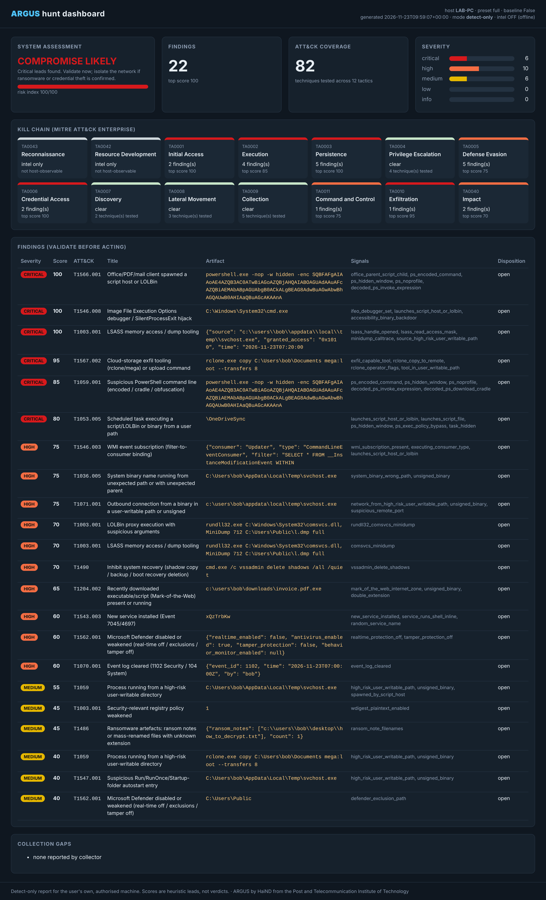
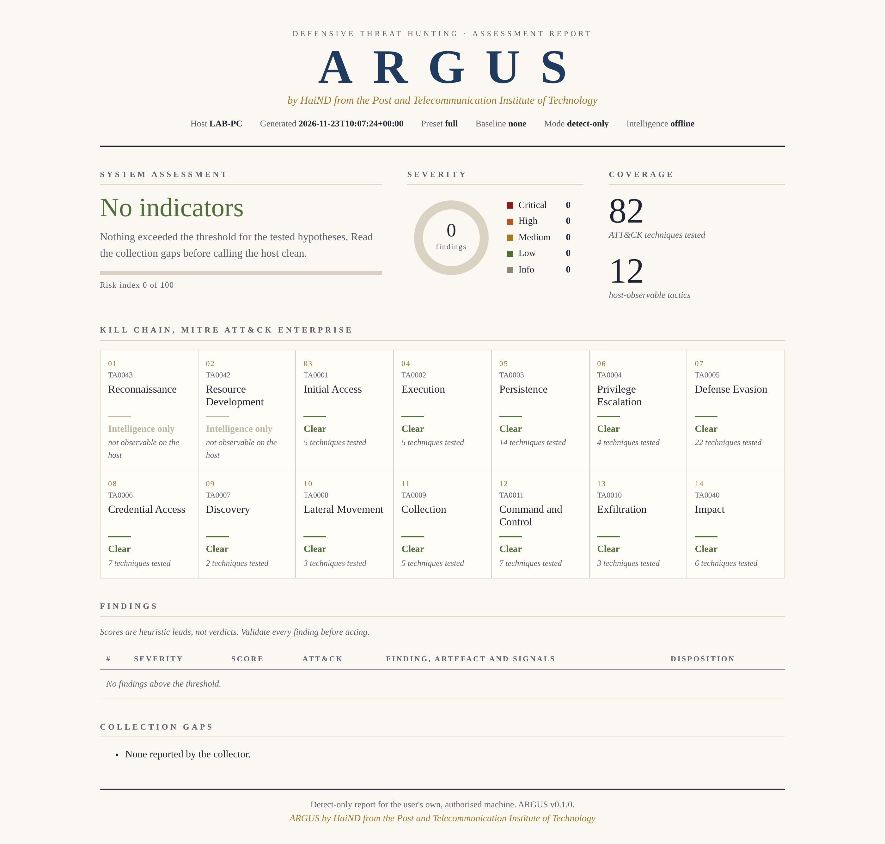
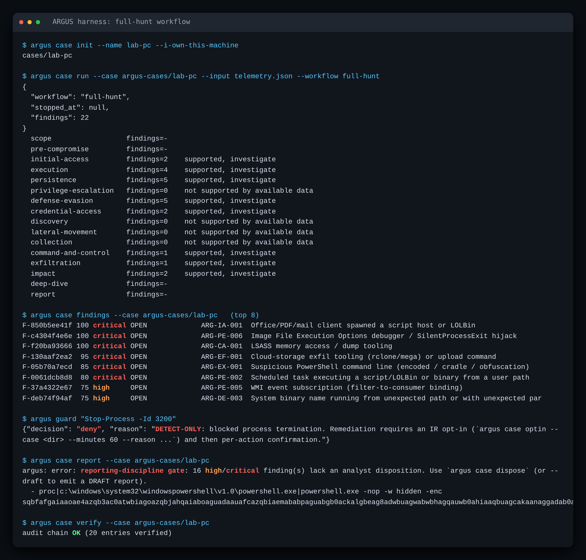
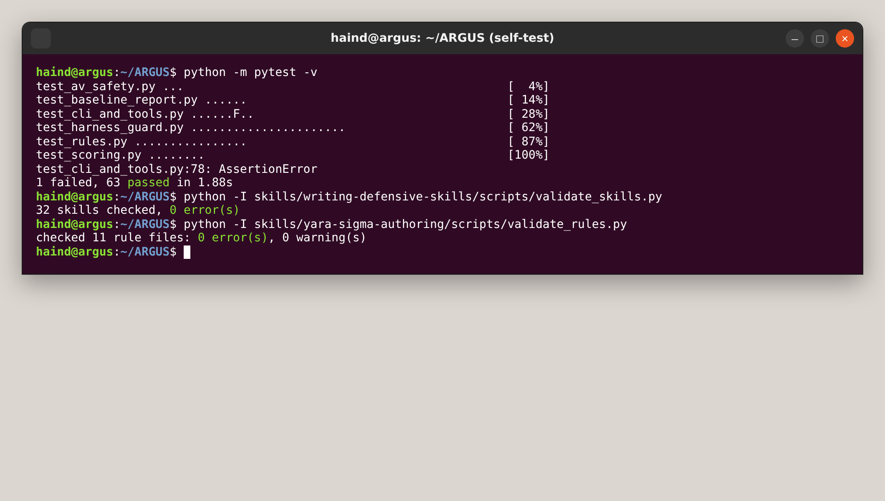

# ARGUS: defensive threat hunting for Claude Code

```text
                █████╗ ██████╗  ██████╗ ██╗   ██╗███████╗
               ██╔══██╗██╔══██╗██╔════╝ ██║   ██║██╔════╝
               ███████║██████╔╝██║  ███╗██║   ██║███████╗
               ██╔══██║██╔══██╗██║   ██║██║   ██║╚════██║
               ██║  ██║██║  ██║╚██████╔╝╚██████╔╝███████║
               ╚═╝  ╚═╝╚═╝  ╚═╝ ╚═════╝  ╚═════╝ ╚══════╝

           defensive threat hunting  |  detect-only  |  MITRE ATT&CK
  ╭──────────────────────────────────────────────────────────────────────╮
  │ by HaiND from the Post and Telecommunication Institute of Technology │
  ╰──────────────────────────────────────────────────────────────────────╯
```

**Author:** by HaiND from the Post and Telecommunication Institute of Technology

**ARGUS** (`defensive-claude`) is the defensive counterpart of offensive skill packs: a set of Claude Code
skills, a Python scoring engine and read-only PowerShell collectors that **hunt malware on your own Windows
PC/laptop** across the MITRE ATT&CK Enterprise matrix. It produces structured JSON, a Markdown hunt report and an
ATT&CK Navigator layer, and wraps everything in a safety harness.

> **Detect-only by default · your own machine only · offline-first.** See [TERMS.md](TERMS.md).

## What makes it different
- **Runnable, not just prose**: read-only collectors (`Collect-Telemetry.ps1`, ~20 artefact sections + event logs),
  a heuristic engine with **~60 rules / 70 ATT&CK techniques**, baseline diffing, static triage, Volatility 3
  memory hunting, artefact/event-log/network/browser forensics.
- **Defensive harness**: cases with a scope attestation, hypothesis-driven workflow phases with gates,
  analyst dispositions, a FINAL-report gate, a SHA-256 hash-chained audit log, and a **PreToolUse guard hook**
  that denies destructive commands unless a time-boxed incident-response opt-in exists (and still asks per action).
- **Privacy**: threat intel is offline by default; VirusTotal / MalwareBazaar lookups are opt-in and send SHA-256 only.
- **AV-safe by construction**: no payload-like literals on disk (test data built from fragments at runtime,
  YARA strings escaped), no embedded dumping/injection code (memory capture uses vendor-signed WinPmem/ProcDump),
  scheduled task runs visibly with `RemoteSigned`, enforced by `tests/test_av_safety.py`. ARGUS never asks you to
  add Defender exclusions.

## Screenshots
**System assessment dashboard** (`*.html`, written next to the JSON/MD/Navigator outputs after every hunt), here on synthetic infected telemetry:



Same dashboard on a clean host, the harness running the full-hunt workflow, and the self-test suite:

| Clean host | Harness run | Self-test |
|---|---|---|
|  |  |  |

## YARA rules
- **Vendored sets (1993 files)** from [Haind03/Exhume](https://github.com/Haind03/Exhume) and [Haind03/Unveil](https://github.com/Haind03/Unveil):
  Neo23x0 signature-base (DRL 1.1), Elastic protections-artifacts (Elastic License 2.0), ReversingLabs (MIT),
  ESET malware-ioc (BSD-2), and custom rules. Stored as `skills/references/yara/vendor/argus-rules.bundle`
  (gzip + XOR mask, the THOR/LOKI approach, so Defender does not quarantine plaintext signature strings);
  decoded only in memory by `engine/argus/yara_bundle.py`. Licences: `skills/references/yara/vendor/LICENSES/`.
  Rebuild: `python -I tools/vendor_yara.py --src <Exhume>/rules --src <Unveil>/rules`.
- **Starter rules** `skills/references/yara/argus_starter.yar` (generated, escaped strings).
- Used by `malware-triage`, `process-memory-analysis` (requires `pip install yara-python`).

## Install
### From a release (pip package or container)
Download from [Releases](https://github.com/Haind03/argus/releases): `argus_defense-0.1.0-py3-none-any.whl`,
`argus-0.1.0-toolkit.zip` (full toolkit: skills, collectors, hooks) and `SHA256SUMS`.
```bash
pip install argus_defense-0.1.0-py3-none-any.whl[yara]      # command: argus
argus hunt --input telemetry.json --preset full
docker run --rm -v "$PWD:/work" ghcr.io/haind03/argus:0.1.0 hunt --input /work/telemetry.json --out-dir /work/reports
```
The pip package and the container contain the engine, presets, workflows and rules (offline analysis of
telemetry collected on Windows). Collectors and Claude Code/Codex skills come from the toolkit zip or a git clone.

### As a Claude Code plugin (recommended)
```
/plugin marketplace add haind03/argus
/plugin install defensive-claude@argus-marketplace
/reload-plugins
```
The plugin auto-loads `skills/`, `commands/`, `agents/` and `hooks/hooks.json` (SessionStart dispatcher +
PreToolUse guard). Local development: `claude --plugin-dir ./ARGUS`.

### Manual copy into `~/.claude/`
```powershell
git clone https://github.com/haind03/argus; cd argus
powershell -NoProfile -ExecutionPolicy RemoteSigned -File .\install.ps1      # Windows
```
```bash
./install.sh                                                                   # macOS / Linux / WSL
```
Copies the toolkit to `~/.claude/argus`, full skill folders to `~/.claude/skills/`, commands and agents, and merges the
hooks into `~/.claude/settings.json` with absolute paths. `settings.json` in this repo is an example permission
profile (read-only actions allowed, state-changing actions asked/denied) you can merge into a project.

Requirements: Windows 10/11, PowerShell 5.1+, Python 3.9+ (stdlib only). Optional: Sysmon, osquery, YARA
(`pip install yara-python`), Volatility 3, tshark, Eric Zimmerman tools, WinPmem, ProcDump, PyYAML.

## Quick start
```powershell
# 1. collect (read-only; elevated prompt gives Security log, Sysmon, WMI, Defender exclusions)
powershell -NoProfile -ExecutionPolicy RemoteSigned -File skills\telemetry-collection\scripts\Collect-Telemetry.ps1 -Sections all -HashProcesses
# 2. score -> JSON + Markdown + Navigator layer
python -I engine\argus_cli.py hunt --input C:\ProgramData\ARGUS\telemetry\telemetry-<HOST>-<ts>.json --preset full
# 3. or run the harness
python -I engine\argus_cli.py case init --name mypc-20261123 --i-own-this-machine
python -I engine\argus_cli.py case run --case argus-cases\mypc-20261123 --input <telemetry.json> --workflow full-hunt
python -I engine\argus_cli.py case findings --case argus-cases\mypc-20261123
python -I engine\argus_cli.py case dispose --case ... --key F-1a2b3c4d5e --verdict false_positive --note "signed vendor updater, in baseline"
python -I engine\argus_cli.py case report --case ... --input <telemetry.json>
```
In Claude Code just use the slash commands: `/hunt.full`, `/hunt.quick`, `/hunt.baseline`, `/hunt.triage <file>`,
`/hunt.persistence`, `/hunt.c2`, `/hunt.report`.

Exit codes: `0` nothing above threshold · `1` findings · `2` high/critical · `3` input/usage error · `4` workflow gate stopped.

## Scheduled scan (Windows Task Scheduler)
```powershell
# baseline first, on a machine you believe is clean (after reviewing a new-machine-baseline hunt)
python -I engine\argus_cli.py baseline --input <telemetry.json> --out-dir C:\ProgramData\ARGUS\baseline --name baseline-20261123.json
# dry run, then register (elevated)
powershell -NoProfile -ExecutionPolicy RemoteSigned -File skills\baseline-and-diff\scripts\Register-ArgusScheduledScan.ps1 -Preset quick -Time 12:30
powershell -NoProfile -ExecutionPolicy RemoteSigned -File skills\baseline-and-diff\scripts\Register-ArgusScheduledScan.ps1 -Preset quick -Time 12:30 -AtLogon -Register
```
Task `\ARGUS\ScheduledHunt` runs as SYSTEM: collect → hunt with the latest baseline → reports in
`C:\ProgramData\ARGUS\reports`; high/critical results write Application event **4100** (source `ARGUS`).
Remove: `-Unregister`. Python must be installed for all users.

## Presets & workflows
| Preset | Use |
|---|---|
| `quick` | daily/scheduled: execution, persistence, evasion, C2, impact; medium+ |
| `full` | all host-observable tactics; low+ |
| `ransomware-focus` | recovery inhibition, service stops, encryption, staging/exfil, credentials |
| `new-machine-baseline` | everything visible (min score 0) for review before saving a baseline |

Workflows (`workflows/*.yml`, JSON twins for PyYAML-less runs): `full-hunt` (14 phases, one per tactic + scope,
deep-dive, report), `incident-investigation` (order of volatility → analysis → opt-in containment),
`ransomware-response`. See [workflows/WORKFLOW-ENGINE.md](workflows/WORKFLOW-ENGINE.md).

## Skill ↔ ATT&CK mapping
| Skill | Tactic | Key techniques (references/) |
|---|---|---|
| initial-access-hunting | TA0001 Initial Access | T1566.001/.002, T1189, T1204.002, T1091, T1133, T1195.002 |
| execution-hunting | TA0002 Execution | T1059.001/.003/.005, T1218, T1047, T1053.005, T1204 |
| persistence-hunting | TA0003 Persistence | T1547.001/.004, T1053.005, T1543.003, T1546.003/.008/.010/.012/.015, T1197, T1136.001, T1176 |
| privesc-hunting | TA0004 Privilege Escalation | T1548.002, T1068, T1574.001/.009, T1543.003 |
| defense-evasion-hunting | TA0005 Defense Evasion | T1562.001/.004, T1070.001, T1036.005, T1055, T1218, T1564.001, T1112, T1140 |
| credential-access-hunting | TA0006 Credential Access | T1003.001/.002, T1555.003, T1552.001, T1110 |
| discovery-hunting | TA0007 Discovery | T1082, T1518.001, T1135 |
| lateral-movement-hunting | TA0008 Lateral Movement | T1021.001/.002/.006, T1570 |
| collection-hunting | TA0009 Collection | T1560.001, T1074.001, T1056.001, T1005 |
| c2-hunting | TA0011 Command and Control | T1071.001, T1105, T1572, T1219, T1568.002, T1102, T1571, T1565.001 |
| exfiltration-hunting | TA0010 Exfiltration | T1567/.002, T1048, T1041 |
| impact-hunting | TA0040 Impact | T1490, T1486, T1489, T1496, T1485 |
| *(intel only)* | TA0043 Reconnaissance, TA0042 Resource Development | not host-observable → IOC lists |

Full machine-readable map: `skills/references/ttp-index.json`; Navigator coverage layer:
`python -I engine/argus_cli.py coverage`. Coverage is honest: all 12 host-observable tactics, ~70 techniques , 
not every Enterprise technique.

### All skills
- **Discipline**: using-argus (dispatcher), scope-discipline, hunt-methodology, evidence-discipline,
  false-positive-discipline, reporting-discipline, writing-defensive-skills
- **Data**: telemetry-collection (+ Sysmon/logging setup, osquery cross-platform), baseline-and-diff (+ scheduled scan)
- **Analysis / forensics**: malware-triage, memory-acquisition, memory-forensics (Volatility 3, 19 plugins),
  process-memory-analysis, disk-forensics (Prefetch/Amcache/BAM/LNK/Recycle/SRUM/MFT), eventlog-forensics,
  network-forensics (beaconing, DGA, DNS tunnelling), browser-forensics, threat-intel-enrichment, yara-sigma-authoring
- **Response (opt-in)**: incident-response

## Repository layout
```
.claude-plugin/   plugin.json, marketplace.json
CLAUDE.md         persona + rules            hooks/       SessionStart dispatcher, PreToolUse guard (python, polyglot launcher)
commands/         /hunt.* slash commands     agents/      hunt-orchestrator, triage-analyst, forensic-analyst, detection-engineer, report-writer
workflows/        hunt kill-chains (YAML)    presets/     quick, full, ransomware-focus, new-machine-baseline
engine/           argus_cli.py + argus/ (rules, scoring, baseline, report, intel, triage, harness, guard)
skills/<name>/    SKILL.md, references/, scripts/          skills/references/  ttp-index, YARA, Sigma, IOC lists
tools/            generators (tactic skills, YARA, workflow JSON, skills-lock)   tests/  pytest
```

## Output formats
- `argus.findings/1` JSON, each finding: `id`, `rule_id`, `artifact`, `technique`, `tactic`, `signals` /
  `signals_matched`, `score` (0-100), `severity`, `action` (recommended analyst action), `baseline_known`, `intel`.
- Markdown report, executive summary, per-tactic counts, findings table + details, baseline changes, collection gaps.
- ATT&CK Navigator layer (`*.navigator.json`), light blue = covered by a rule, coloured = finding severity.

## Development
```bash
python -m pytest                                        # scoring, rules, baseline, harness, guard, CLI, AV-safety
python -I skills/writing-defensive-skills/scripts/validate_skills.py
python -I skills/yara-sigma-authoring/scripts/validate_rules.py
python -I tools/gen_tactic_skills.py   # after editing tools/techdata.py
python -I tools/build_yara.py          # after editing YARA specs
python -I tools/sync_workflows.py      # after editing workflows/*.yml (needs PyYAML)
python -I tools/lock.py                # refresh skills-lock.json
python -I tests/synthetic.py demo.json # synthetic infected telemetry for demos (built in memory, never executed)
```

## License
MIT, see [LICENSE](LICENSE). Third-party tools keep their own licences.

---
ARGUS by HaiND from the Post and Telecommunication Institute of Technology.
